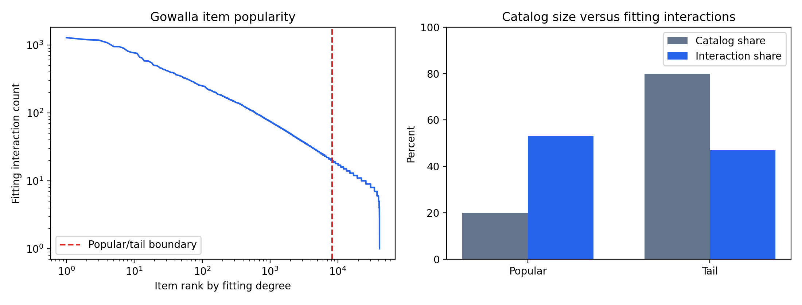

# Does LightGCN Favor Popular Items?

CSC 591/791-038: Machine Learning for Graphs — Group 5, Fall 2026.

Team: Sachi Vyas, Sakhi Patel, and Vaishvi Patel.

We study how LightGCN's propagation depth, layer weights, and degree normalization affect recommendation accuracy and exposure for less popular items. The data pipeline, MostPopular baseline, continued three-layer LightGCN run, and zero-layer BPR-MF comparison have completed on ARC. Selected checkpoints were evaluated for accuracy and popularity exposure on validation data. Results use one training seed and remain preliminary research findings.

## Research questions

1. How does increasing the number of propagation layers affect popularity exposure?
2. Does combining layers behave differently from using only the final layer?
3. How do APPNP-style layer weights change accuracy and tail exposure?
4. What trade-offs arise from stronger degree-based neighbor down-weighting?
5. Do item embedding norms and recommendation frequencies correlate with item degree?

This is a controlled reproduction and ablation study. Popularity amplification in graph recommenders is already studied in prior work; we do not claim to discover it for the first time.

## Start here

- [Completed work and measured results](#results)
- [Setup and ARC commands](#getting-started)
- [Experiment protocol and work split](docs/experiments.md)
- [Result files and provenance](results/README.md)

## Getting started

Use Python 3.10. The observed ARC environment used Python 3.10.22, PyTorch 2.5.1+cu121, and an RTX 4060 Ti with 16 GB GPU memory.

From the repository root, install the CUDA-enabled wheel, followed by the recorded direct dependencies:

```bash
python -m pip install torch==2.5.1 --index-url https://download.pytorch.org/whl/cu121
python -m pip install -r requirements.txt
```

Download the author-linked upstream code and processed datasets into the ignored checkout directory. Follow its applicable licensing and data-use terms.

```bash
git clone https://github.com/gusye1234/LightGCN-PyTorch.git LightGCN-PyTorch
git -C LightGCN-PyTorch checkout "$(cat provenance/upstream-commit.txt)"
python scripts/prepare_gowalla.py
python scripts/analyze_popularity.py
python scripts/evaluate_mostpopular.py
```

The recorded [upstream commit](provenance/upstream-commit.txt) is `947ca2b3b1d2d3545b114145710cb06c4e57b3d2`. The actual [ARC environment export](provenance/environment-freeze.txt) is included for provenance. Its `packaging` entry references a local Conda build, so use the installation commands above rather than installing that raw export directly. `requirements.txt` records observed direct dependencies rather than a full lockfile.

On an allocated GPU node, run a two-epoch check:

```bash
OMP_NUM_THREADS=4 MKL_NUM_THREADS=4 python -u scripts/train_validation.py \
  --dataset gowalla --model lgn --layer 3 --recdim 64 \
  --bpr_batch 1024 --lr 0.001 --decay 0.0001 --epochs 2 \
  --seed 2020 --topks "[20]" --testbatch 256 --tensorboard 0 --multicore 0
```

For ARC batch training, set `PROJECT_ROOT` to this repository's absolute cluster path. Submit from your home filesystem:

```bash
export PROJECT_ROOT="/absolute/path/to/lightgcn-popularity-bias"
cd "$HOME"
sbatch --output="$HOME/lightgcn-k3-%j.out" "$PROJECT_ROOT/scripts/train_arc.sh"
```

The batch script assumes the already-created environment at `/mnt/beegfs/$USER/conda/envs/lightgcn`. Adapt that path for another environment. It starts a fresh run with a 200-epoch maximum. The recorded baseline run has completed; submitting this script starts a new run.

### Optional early stopping

Add `--early-stopping-patience 20` to the Python training command to stop after 20 consecutive validation checks without a new highest Recall@20. Validation runs once per epoch. Any strictly higher recall resets the counter. A value of `0`, the default, runs the full epoch budget.

For the ARC batch script, set the stopping rule before submitting the job.

```bash
export EARLY_STOPPING_PATIENCE=20
sbatch --output="$HOME/lightgcn-k3-%j.out" "$PROJECT_ROOT/scripts/train_arc.sh"
```

The stopping settings are recorded in `config.json`. A completed run also writes `run-summary.json` with its actual epoch count, stopping reason, and best epoch. `best.pt` retains the highest-validation-recall checkpoint and `last.pt` records the final training epoch. Use the same epoch budget and stopping rule for compared model variants and baselines. Re-run the standard baseline when evaluating a new stopping protocol.

### Continue an existing run

Add `--resume /absolute/path/to/last.pt` to the training command. Set `--epochs` to the total epoch limit, such as `500` when continuing after epoch 200. Keep the seed and model configuration identical to the saved run. The wrapper checks the split hashes, restores model and optimizer states, and reconstructs the best checkpoint and stopping counter from the parent history.

The continuation writes a new run directory containing the parent history and additional epochs. It copies the previous best checkpoint into the new directory before training. New checkpoints also save Python, NumPy, and PyTorch random-generator states. The original 200-epoch checkpoint lacks these states, so its continuation restarts sampling from seed 2020. Its future trajectory can differ from uninterrupted training.

The ARC continuation script requests any available node in the RTX 4060 Ti 16 GB partition, a total limit of 500 epochs, and patience 20. The checkpoint can be continued on another compatible GPU node.

```bash
export PROJECT_ROOT="/absolute/path/to/lightgcn-popularity-bias"
cd "$HOME"
sbatch --output="$HOME/lightgcn-k3-resume-%j.out" "$PROJECT_ROOT/scripts/resume_arc.sh"
```

### Matrix factorization comparison

The MF comparison uses the upstream LightGCN class with `--model lgn --layer 0`. It learns user and item embeddings with the same initialization, BPR loss, optimizer, and regularization as the standard LightGCN baseline. With zero propagation steps, scores use the embeddings directly. The saved model label is `BPR-MF`.

Submit the two-epoch training and evaluation check first, then the full run. Both submissions evaluate the best saved checkpoint for relevance and exposure after training. Each job writes to a separate `mf-k0-seed2020-job<job-id>` directory under `results/gowalla/`.

```bash
export PROJECT_ROOT="/absolute/path/to/lightgcn-popularity-bias"
cd "$HOME"
sbatch --job-name=mf-k0-check --time=00:15:00 --export=ALL,MAX_EPOCHS=2 \
  --output="$HOME/mf-k0-check-%j.out" "$PROJECT_ROOT/scripts/train_mf_arc.sh"
# After the check completes successfully, submit the full comparison.
sbatch --output="$HOME/mf-k0-%j.out" "$PROJECT_ROOT/scripts/train_mf_arc.sh"
```

The full run uses seed 2020, at most 500 epochs, and early-stopping patience 20. Evaluation uses the existing fixed validation split and popular/tail groups. The original test split is reserved for final evaluation.

### Layer-depth comparison

Submit one job per depth. Each job uses seed 2020, a 500-epoch maximum, patience 20, and automatic best-checkpoint validation evaluation. The completed K=3 continuation supplies the current three-layer result.

```bash
export PROJECT_ROOT="/absolute/path/to/lightgcn-popularity-bias"
cd "$HOME"
for LAYERS in 1 2 4; do
  sbatch --job-name="lightgcn-k${LAYERS}" --export=ALL,LAYERS="$LAYERS" \
    --output="$HOME/lightgcn-k${LAYERS}-%j.out" "$PROJECT_ROOT/scripts/train_layers_arc.sh"
done
```

Each job writes a unique `lightgcn-k<layers>-seed2020-job<job-id>` directory under `results/gowalla/`. The six-hour Slurm limit allows for slower deeper runs. Training still stops at 500 epochs or the patience threshold. Set `TRAINING_SEED` to repeat the comparison with another seed. The training wrapper installs split files atomically so simultaneous jobs can read the same split safely.

The training wrapper supplies fitting interactions and validation interactions to the upstream loader in a separate hash-keyed directory. Its `test.txt` is validation data; the supplied final test set is not evaluated. Graph caches are isolated by split hashes. Each run saves `config.json`, `history.csv`, `best.pt` (selected by validation Recall@20), and `last.pt`.

To evaluate a trusted checkpoint on validation data, set `RUN_DIR` to its directory and run on an allocated GPU node:

```bash
python scripts/evaluate_lightgcn.py --run-dir "$RUN_DIR"
```

This writes `best-validation-metrics.json` and `best-validation-exposure.csv` inside that run. Checkpoints remain on ARC; they are not stored on GitHub. The evaluator verifies the split hashes and uses the saved popular/tail item groups.


The repository scripts were recovered from the team's shared terminal logs and adapted to live under `scripts/`. ARC's existing root-level scripts and checkpoints were not changed by this GitHub sync.

## Repository layout

| Path | Contents |
| --- | --- |
| [docs/proposal.pdf](docs/proposal.pdf) | Submitted project proposal |
| [docs/experiments.md](docs/experiments.md) | Shared protocol, planned variants, and independent work tracks |
| [scripts/](scripts/) | Data preparation, analysis, training, evaluation, and ARC submission |
| [configs/](configs/) | Reference experiment specifications |
| [results/README.md](results/README.md) | Completed results and artifact index |
| [results/gowalla/archive/](results/gowalla/archive/) | Earlier snapshots and the two-epoch check |
| [provenance/](provenance/) | Original ARC environment export and upstream commit |
| [data/README.md](data/README.md) | Local data instructions |

Local datasets, environments, graph caches, checkpoints, and presentation exports are excluded from Git.

## Script guide

Run these commands from the repository root. Training and checkpoint evaluation require an allocated GPU node.

| Script | Purpose |
| --- | --- |
| `scripts/prepare_gowalla.py` | Create the fixed fitting/validation split under `prepared/gowalla/` |
| `scripts/analyze_popularity.py` | Save fitting-degree groups and the popularity figure |
| `scripts/evaluate_mostpopular.py` | Evaluate the popularity-count baseline on validation |
| `scripts/train_validation.py` | Train standard LightGCN and save histories and checkpoints |
| `scripts/evaluate_lightgcn.py --run-dir "$RUN_DIR"` | Evaluate a saved standard LightGCN checkpoint for relevance and exposure |
| `scripts/train_arc.sh` | Submit the standard 200-epoch K=3 run through Slurm |
| `scripts/resume_arc.sh` | Continue the K=3 checkpoint on an available RTX 4060 Ti 16 GB node, up to epoch 500 with patience 20 |
| `scripts/train_mf_arc.sh` | Train zero-layer BPR-MF and evaluate its best checkpoint, with a 500-epoch maximum and patience 20 |
| `scripts/train_layers_arc.sh` | Train and evaluate a selected LightGCN depth, with a unique run directory per job |

The wrapper supports standard LightGCN at different depths and the zero-layer BPR-MF comparison. LightGCN-single, APPNP-style weights, and normalization changes are planned in [the experiment guide](docs/experiments.md). The JSON configuration in `configs/` is a reference specification. The scripts currently receive training settings through CLI arguments. Use `--run-dir` to choose a fresh output directory for a training run.

## Results

All measurements below use the same fitting/validation split and 29,858 validation users. Each trained model uses seed 2020. The final test set remains reserved for final evaluation.

| Model | Best epoch | Stopped epoch | Recall@20 | NDCG@20 | Tail share | Coverage | Gini | Tail recall |
| --- | ---: | ---: | ---: | ---: | ---: | ---: | ---: | ---: |
| MostPopular | — | — | 0.02715 | 0.01298 | 0.00% | 0.09% | 0.99950 | 0.00000 |
| BPR-MF, zero layers | 213 | 233 | 0.15508 | 0.07783 | 19.20% | 57.58% | 0.85743 | 0.05536 |
| LightGCN, three layers, continued | 246 | 266 | 0.19245 | 0.10049 | 10.66% | 36.63% | 0.93083 | 0.04851 |
| LightGCN, original 200-epoch run | 192 | 200 | 0.18968 | 0.09853 | 10.59% | 35.50% | 0.93371 | 0.04615 |

The continued LightGCN and MF runs used a 500-epoch maximum and patience 20. Both stopped after 20 consecutive epochs without a new highest validation Recall@20. The original LightGCN run is retained as a historical reference.

LightGCN achieved higher overall recall than MF. MF achieved higher tail share, tail recall, and catalog coverage, with lower exposure Gini. This initial comparison suggests an accuracy–exposure trade-off. Repeated seeds and the planned model ablations are needed to assess how stable the pattern is.

The LightGCN continuation restored the epoch-200 model and optimizer. Its parent history never reached 20 consecutive non-improving epochs, so the stopping counter could be reconstructed and carried forward. The old checkpoint lacked random-generator states, so sampling restarted from seed 2020 at the continuation boundary. This is recorded in its configuration and limits comparisons with uninterrupted training.

The most popular 8,197 of 40,981 items account for 53.09% of the 737,091 fitting interactions. Popularity groups are fixed across all evaluations. Tail recall is averaged over the same 18,987 users with tail positives in validation.

[Continued LightGCN artifacts](results/gowalla/lightgcn-k3-seed2020-20261105-001600-153197/), [MF artifacts](results/gowalla/mf-k0-seed2020-job327067/), and [the comparison CSV](results/gowalla/comparison.csv) include the completed measurements. [The results guide](results/README.md) indexes historical and current artifacts. Checkpoints remain on ARC.



## References

- He et al. [LightGCN: Simplifying and Powering Graph Convolution Network for Recommendation](https://arxiv.org/abs/2002.02126), 2020.
- Wu et al. [Simplifying Graph Convolutional Networks](https://arxiv.org/abs/1902.07153), 2019.
- Gasteiger et al. [Predict then Propagate: Graph Neural Networks meet Personalized PageRank](https://arxiv.org/abs/1810.05997), 2019.
- Chen et al. [How Graph Convolutions Amplify Popularity Bias for Recommendation?](https://arxiv.org/abs/2305.14886), 2023 preprint.

External code must retain its original attribution and license. No license for redistribution of this team's original work has been selected yet.
