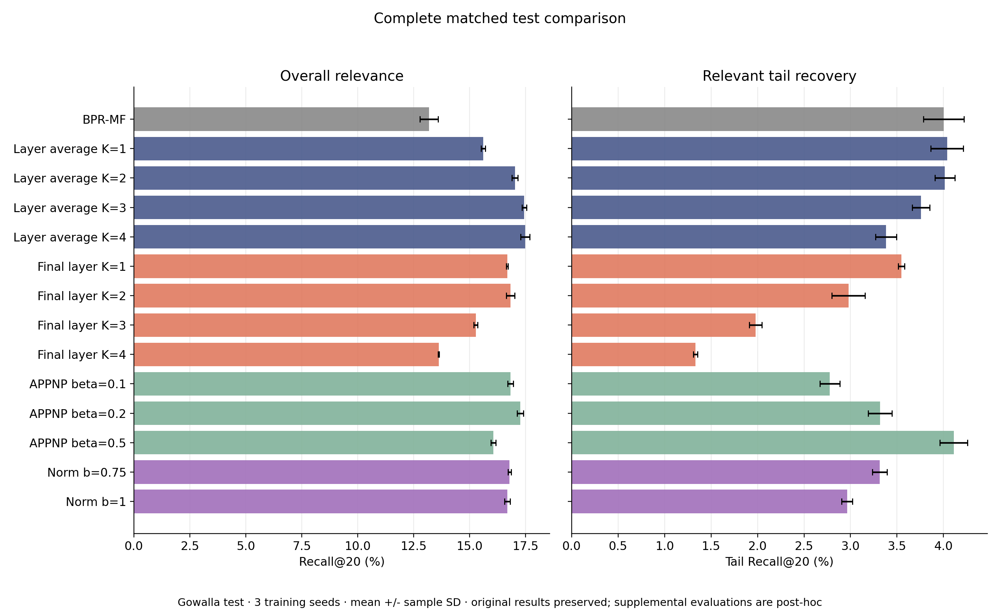
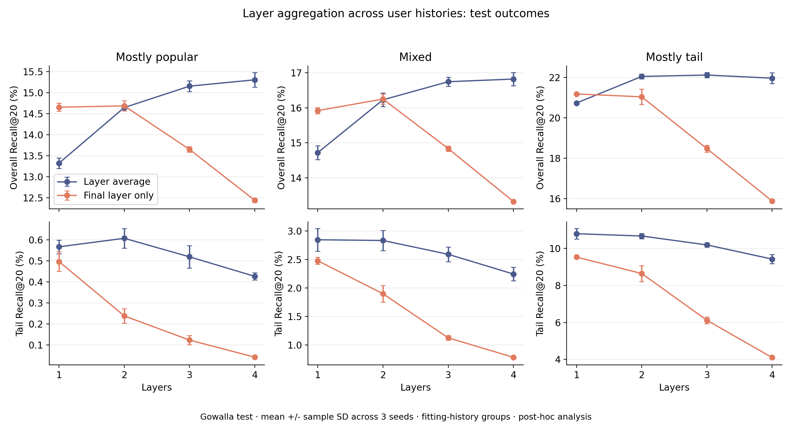

# Completed supplemental test comparison

**Completed November 23, 2026:** evaluation job **346586**, node **c1**, and report/figure job **346593**, both exit 0. All 24 validation checks passed before the evaluator opened test labels. The extension then completed **18 first-time test evaluations and 6 repeated test checks** for matched user-group analysis.

The original test results were already known when this extension was planned. The checkpoint roster, settings, selected epochs, grouping rules, exclusions and numerical tolerances were fixed before the new evaluations. No model was retrained, retuned, reselected or given extra epochs. The first protocol commit is `3614254`; a metadata-label correction during validation was frozen in `bb6bbd2`, before any new test access.

## Start here

- [Full 14-setting, three-seed test table](comparison.md)
- [Accuracy cost and tail-recovery gains relative to standard K=3](accuracy-tradeoffs.md)
- [42 matched per-run results and their origins](comparison-per-run.csv)
- [Three-seed test means and sample SD](comparison-summary.csv)
- [All 126 user-group rows](user-groups-per-run.csv) and [group summaries](user-groups-summary.csv)
- [Independent artifact audit](artifact-audit.json), [validation gate](validation-verification.json), [test completion](test-completion.json), and [frozen protocol](../../../provenance/extended-test-plan.json)

## What this completes

| Family | Test coverage before this extension | Test coverage now |
| --- | --- | --- |
| MF and standard LightGCN K=1-4 | Three seeds | Preserved, unchanged |
| LightGCN-single K=1-4 | Seed 2020 only | Three seeds at every depth |
| APPNP beta=0.1 and 0.2 | Seed 2020 only | Three seeds for each beta |
| APPNP beta=0.5 | Three seeds | Preserved, unchanged |
| Selected a=0.25 normalization, b=0.75 and 1 | No test evaluation | Three seeds for each setting |

The combined comparison contains 14 settings x 3 seeds = 42 checkpoint results. It preserves the 18 original main test values and 6 earlier seed-2020 test values, adding 18 new values. MostPopular remains a separate deterministic reference in the original test report. Earlier fixed-a=0.5 normalization variants remain separate exploratory results; they are not silently pooled with the selected a=0.25 settings.

## Findings

**Layer aggregation:** averaging has higher overall tail recall, tail share and coverage than final-layer-only output at every matched depth and seed (12 of 12 comparisons for each metric). Single-output mean test overall recall is slightly higher at K=2 than K=1 (0.1684 versus 0.1669), before falling at K=3/4. Its mean tail recall declines throughout (0.0355, 0.0298, 0.0198, 0.0133). Do not carry the strictly decreasing validation overall-recall pattern over to test.

**User histories:** averaging has higher tail share and coverage in all 36 matched depth/seed/group comparisons. It has higher tail recall in 35 of 36. The exception is mostly-popular users at K=1, seed2021: single output has Tail Recall@20 0.005488, versus 0.005297 for averaging. Averaging still has higher mean tail recall at every depth within every group. The groups describe fitting histories, not true preferences or causal fairness effects.

**Weights:** beta=0.5 has the largest mean tail recall among the three tested APPNP weights and among all 14 settings, with lower overall recall than standard K=3. Beta=0.1 and 0.2 have lower overall recall, tail recall and tail share than standard K=3 in each test seed. The mean beta=0.2 overall-recall gap is small, but it does not provide a tail-recovery benefit in this comparison.

**Normalization:** selected a=0.25 with b=0.75 or 1 has lower overall recall, tail recall and tail share than standard K=3 in each seed. Mean Recall@20 / Tail Recall@20 are 0.1679 / 0.0331 for b=0.75 and 0.1669 / 0.0296 for b=1, versus 0.1745 / 0.0376 for standard K=3. The hoped-for tail benefit is unsupported in the tested grid, now also on three-seed test data.



## Direct answer to the proposal's accuracy-cost question

Compared with standard K=3, on existing matched three-seed test means:

| Setting | Overall Recall@20 change | Tail Recall@20 change | Tail-share change |
| --- | ---: | ---: | ---: |
| Standard K=2 | -0.420 percentage points | +0.257 points | +1.641 points |
| APPNP beta=0.5 | -1.380 percentage points | +0.353 points | +3.323 points |

These are descriptive trade-offs. They do not establish statistical significance or select a new model using test outcomes. Tail share measures exposure; tail recall measures recovery of relevant tail items, with a different user denominator from overall recall.



## Protocol, denominators and limits

- Test labels come from the pinned authors' Gowalla split. Models use the same fitting-only graph and training-popularity labels. Test rankings exclude fitting plus validation positives.
- Overall metrics use 29,858 users, top-20 recommendations and a 40,981-item catalog. Test tail recall uses 26,839 users with held-out tail positives. User-history group counts are 8,196, 15,331 and 6,331; their test-tail denominators are 6,755, 14,126 and 5,958.
- Checkpoints were selected by validation recall under the common 500-epoch cap and patience 20. APPNP beta=0.1 seed2021 reached the cap and selected epoch 498. Keep this limitation explicit; these results do not establish that every run converged.
- Holding out validation interactions reduces fitting data relative to the original paper's full training split. Report a controlled reproduction and ablation study, not an exact reproduction of the published score.
- Original test and validation findings remain intact. Supplemental testing is post-hoc and uses the same test split already viewed earlier. Three seeds measure training variation; they are not independent dataset splits or a formal significance analysis.
- Q4 remains an association analysis: popular items tend to have larger final embedding magnitudes, but this does not consistently strengthen with depth. These additional test evaluations do not establish a causal embedding-based explanation.

## Audits and reproducibility

All checkpoint/data/source identities passed. The validation gate verifies all six saved validation metrics and item-exposure counts. Six repeated test checks reproduce earlier references. The largest observed absolute reference-metric deviation is 0.0000016746, with exposure-count L1 difference at most 2, within the frozen tolerances of 1e-5 and 20. Group exposure vectors reconcile exactly within each inference run, and weighted group recall, NDCG, tail recall and tail share reconcile with that rerun's overall values.

The artifact audit independently recomputes exposure-based metrics, checks the verification gates and grouped denominators, and rebuilds all means, sample SD and accuracy-cost tables. It passed on ARC and after download. It does not independently rerank recall metrics without weights and data.

```bash
python scripts/build_extended_test_report.py results/gowalla/extended-test-job346586 --check
```

To rebuild tables, omit `--check`. Plotting uses:

```bash
python scripts/plot_extended_test.py results/gowalla/extended-test-job346586
```

The table/audit commands use Python's standard library; plotting additionally needs NumPy and Matplotlib. The [source snapshot](inference-sources.tar.gz) preserves the inference sources and plan matching the canonical hashes. Complete evaluator outputs are in `verify/` and `test/`, and both job logs are included.

No user IDs, per-user histories, assignments or individual recommendation lists are exported. Public records contain aggregate metrics, user-group statistics and item-level recommendation counts. Checkpoint weights remain on ARC.
