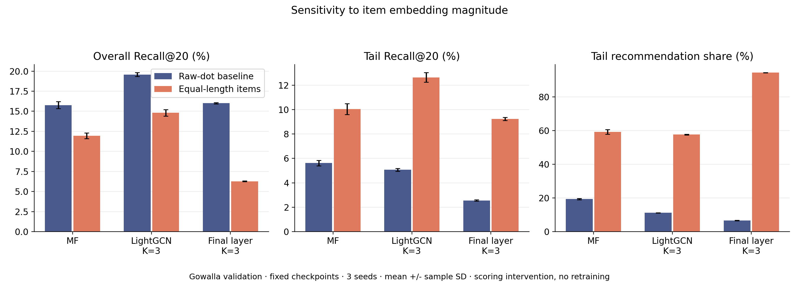
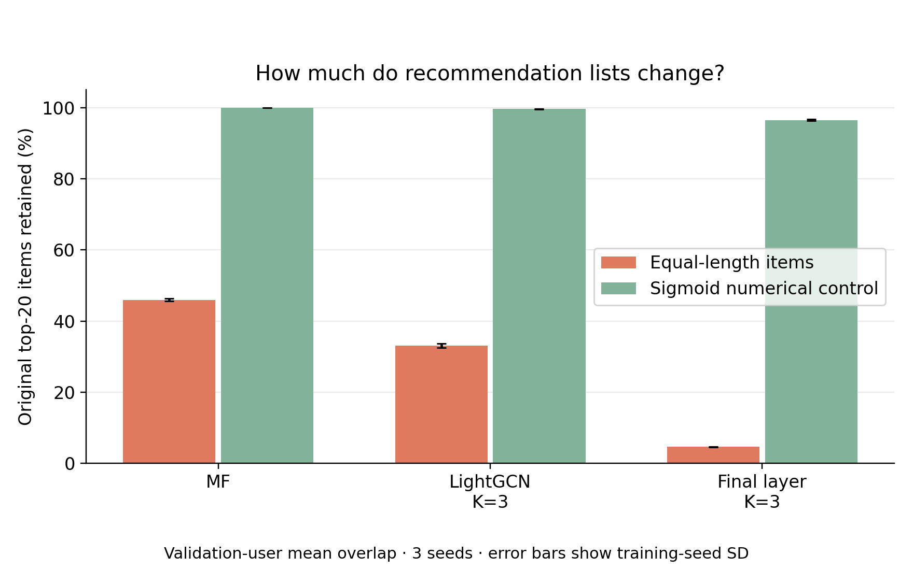

# Does item embedding magnitude affect recommendations?

Completed November 24, 2026. **Exploratory validation only**, using nine existing checkpoints: MF, standard LightGCN K=3 and LightGCN-single K=3, each at seeds 2020, 2021 and 2022. No retraining, new checkpoint selection or new test evaluation. Earlier test results are preserved.

## What we changed

An embedding is a vector representing a user or item. Its magnitude is its mathematical length (L2 norm), not the number of dimensions. All embeddings still have 64 dimensions.

For each fixed checkpoint, we compared ordinary raw dot-product rankings with rankings after dividing each final item vector by its length. This keeps item direction and every user vector unchanged. For a nonzero user, the new ranking is equivalent to cosine-similarity ranking. The graph and its degree normalization are unchanged. This is a scoring intervention after training, distinct from the earlier normalization-exponent experiments.

Ordinary scores combine item magnitude and user-item directional alignment. Equal-length scoring removes the item-magnitude factor. The vectors were learned jointly under the original dot-product objective, so this comparison measures ranking sensitivity to a changed scoring rule.

## Main finding

**Equal-length item vectors substantially change rankings: they improve recovery of held-out tail items and increase tail exposure, but sacrifice overall recall.** The direction of this trade-off holds in all nine seed/model pairs and all 27 matched user-group/seed/model comparisons. This is descriptive replication across training seeds, not a significance test.

Three-seed validation means (raw dot product -> equal-length items):

| Model | Overall Recall@20 | Tail Recall@20 | Tail share | Original top-20 items retained |
| --- | ---: | ---: | ---: | ---: |
| MF | 0.15771 -> 0.11954 | 0.05621 -> 0.10038 | 19.38% -> 59.19% | 45.96% |
| Standard LightGCN K=3 | 0.19578 -> 0.14807 | 0.05070 -> 0.12639 | 11.16% -> 57.59% | 33.05% |
| LightGCN-single K=3 | 0.16004 -> 0.06279 | 0.02554 -> 0.09236 | 6.63% -> 94.34% | 4.63% |

Standard K=3 gains about 7.57 percentage points of tail recall while losing 4.77 points of overall recall. Its coverage rises from 38.03% to 97.13%. The final-only model changes most dramatically and loses about 9.73 points of overall recall. Its very high tail share is therefore not evidence of a universally better recommender. The tail contains roughly 80% of catalog items; exposure alone does not establish relevance or fairness.



[Full means and sample SD](comparison.md) include NDCG, coverage and Gini. [Paired changes](paired-changes.md) summarize within-checkpoint effects rather than subtracting unrelated runs. Group statistics use the existing fitting-history groups; no new grouping thresholds were selected.

## Numerical scoring control

The earlier evaluator applies sigmoid before ranking. Sigmoid preserves order in exact arithmetic, but finite-precision ties can change recommendations. To isolate the magnitude intervention, both primary arms use raw scores. We separately repeat legacy sigmoid scoring on the same embeddings.

Legacy sigmoid retains about 99.90%, 99.62% and 96.53% of raw-dot top-20 items for MF, standard K=3 and final-only K=3 respectively. These numerical differences are much smaller than the equal-length intervention, but are measurable, especially for final-only output. Raw-dot baselines here should not be substituted into the earlier legacy tables without labeling the scoring change.



## What this adds to Q4

The original correlation analysis asks whether popular items tend to have larger vectors. This follow-up asks whether recommendations change when that length factor is removed from scoring. They do, with a consistent accuracy/tail trade-off across the tested checkpoints. This strengthens the interpretation beyond correlation alone, while **not proving that embedding magnitude caused popularity bias during training**. Directions and magnitudes were learned together, and we did not retrain with cosine scoring, sweep depths or establish an optimal intervention strength.

The intervention was frozen after earlier test results had already been viewed. Its outcomes are validation diagnostics and cannot establish performance on an unseen test or another dataset. Tail recall measures held-out recorded interactions, not unobserved true preferences or online benefit.

## Verification and files

The [frozen protocol](../../../docs/magnitude-diagnostic.md) and [plan](../../../provenance/magnitude-plan.json) specify all nine checkpoint hashes, source/data hashes, epsilon, controls, masks and tolerances. All nine original legacy evaluations passed before the intervention phase. No zero or sub-epsilon item vectors, or zero user vectors, were encountered. Hand-built scoring checks passed, including a known ranking reversal and item-scale invariance.

- `verify/`: nine legacy validation reproductions and item exposure tables.
- `analyze/`: 27 scoring evaluations, with overall and grouped metrics and item exposure tables.
- `*-item-norms.csv.gz`: item IDs, fitting degrees and original final-vector norms; no user histories or individual recommendation lists.
- `comparison-per-run.csv`, `comparison-summary.csv`: all scoring arms, three-seed mean and sample SD.
- `paired-effects.csv`, `paired-summary.csv`, `ranking-changes.json`: metric deltas, overlap, Jaccard, top-1/list changes and group summaries.
- `user-groups-per-run.csv`, `user-groups-summary.csv`, `group-profiles.csv`: aggregate history-group outcomes and denominators.
- `validation-verification.json`, `analysis-completion.json`, `artifact-audit.json`: frozen identities, completion and audit records.
- `inference-sources.tar.gz`: exact inference-source and plan snapshot; reporting helpers are versioned under `scripts/`.
- `magnitude-347014.out`, `magnitude-report-347032.out`: successful ARC execution logs. Both jobs exited with code zero.

The local audit rebuilds aggregate tables, checks exposure-derived metrics, original references, source snapshots, group pooling and seed summaries. Individual rankings and relevance hits are measured by inference; they cannot be independently reconstructed from public aggregates alone.

```bash
python scripts/build_magnitude_report.py results/gowalla/magnitude-job347014 --check
python scripts/plot_magnitude.py results/gowalla/magnitude-job347014
```

The audit needs only Python's standard library. Plotting needs NumPy and Matplotlib. Checkpoint inference additionally requires PyTorch, the pinned upstream code/data and access to the frozen weights; see `scripts/analyze_magnitude_arc.sh`. No ARC account is required to read the exported results.
