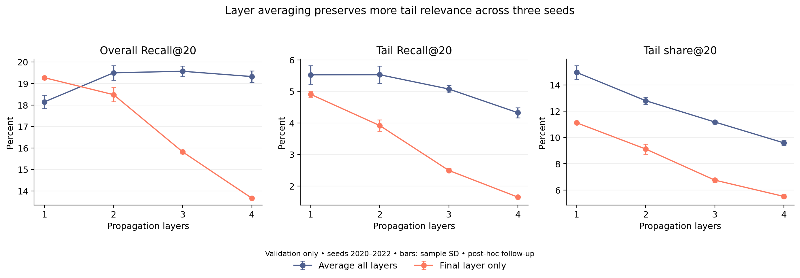
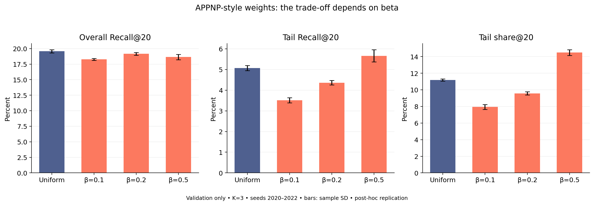
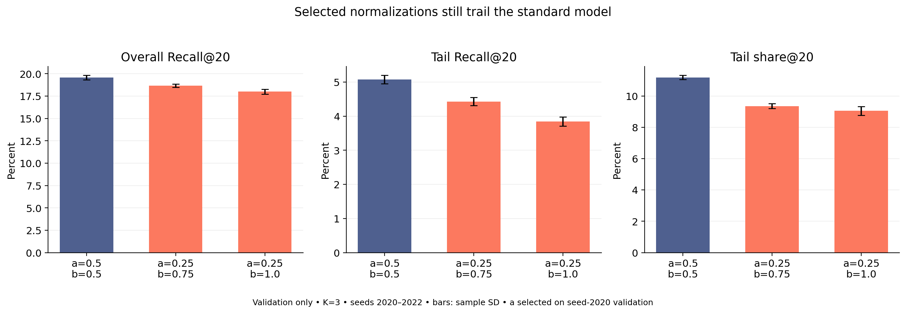

# Completed proposal follow-up: three-seed validation results

**All jobs completed successfully.** This export contains the six new normalization-search fits, twelve additional-seed fits, and four selected-normalization replications. With reused references, the follow-up summarizes nine settings across three seeds. The expanded comparison includes all fourteen matched three-seed settings (42 runs).

**Teammates do not need ARC to review these runs.** [Open the run index](runs.md) for direct links to every new run's configuration, epoch history, selected-checkpoint metrics, full item-exposure table, provenance and scheduler log. Checkpoint weights remain on ARC and are not included; these artifacts permit result review and summary reconstruction, but not independent checkpoint inference.

## Start here

- [Full fourteen-model validation comparison, mean ± sample SD](comparison.md)
- [Every new run and its files](runs.md)
- [Normalization grid: all nine candidate measurements](normalization-grid.csv)
- [Frozen selected settings and reused/new replications](normalization-selection.json)
- [Expanded per-run CSV](expanded-validation-per-run.csv) and [summary CSV](expanded-validation-summary.csv)
- [Artifact audit](artifact-audit.json), [completion record](completion.json), and [frozen protocol](../../../provenance/proposal-completion-plan.json)

The deterministic [MostPopular validation baseline](../mostpopular-validation.json) remains available separately; it does not have training-seed variation and is not pooled into the fourteen three-seed settings.

## What changed in the evidence

| Experiment | Previously available | Now available |
| --- | --- | --- |
| LightGCN-single K=1–4 | Seed 2020 validation and supplemental test | Three-seed validation at every depth; test remains seed 2020 only |
| APPNP beta=0.1 and 0.2 | Seed 2020 validation/test | Three-seed validation; test remains seed 2020 only |
| Normalization | a fixed at 0.5; b=0.75 and 1.0, seed 2020 | Validation search over a={0,0.25,0.5} per b, followed by three-seed validation of selected settings |

This follow-up was planned after the original test results were viewed. It uses validation only, does not revise original test results, and does not establish three-seed test performance for newly replicated variants. Do not combine the new validation values with the old test values in one comparison without explicit split labels.

## Findings

**Layer averaging:** standard averaging has higher tail recall than final-layer-only output at every depth in every seed. Final-layer-only mean tail recall drops from 4.91% at K=1 to 1.65% at K=4. It also loses exposure and coverage with depth. At K=1 it has higher mean overall recall than standard averaging; at K=2–4 it has lower mean overall recall. Keeping earlier layers therefore helps tail recovery in this comparison, but does not win every metric.



**APPNP:** beta=0.5 retains the strongest mean tail recall of the tested weights. Mean validation Recall@20 / Tail Recall@20 are 18.26% / 3.51% for beta=0.1, 19.15% / 4.37% for beta=0.2, and 18.64% / 5.66% for beta=0.5. Standard K=3 gives 19.57% / 5.07%. Changing the weighting changes the accuracy/tail-recovery trade-off; smaller beta does not automatically improve tail recommendations.



**Normalization:** the seed-2020 validation search selected a=0.5 for b=0.5, and a=0.25 for b=0.75 and b=1.0. The same selected a was then used for seeds 2021 and 2022. Standard K=3 was reused for a=b=0.5 rather than retrained.

| Selected normalization | Mean validation Recall@20 | Mean tail Recall@20 | Mean tail share |
| --- | ---: | ---: | ---: |
| a=0.5, b=0.5 | 19.57% | 5.07% | 11.18% |
| a=0.25, b=0.75 | 18.66% | 4.43% | 9.36% |
| a=0.25, b=1.0 | 18.00% | 3.84% | 9.05% |

Tuning a improves seed-2020 overall recall over the earlier fixed-a=0.5 runs: 18.21% to 18.59% at b=0.75 and 17.32% to 17.96% at b=1.0. It does not improve every tail metric: at b=1.0, seed-2020 tail recall falls from 4.21% to 3.81%. The tuned variants still trail standard K=3 in mean overall recall, tail recall and tail share across three seeds. The hoped-for popularity benefit remains unsupported for these tested settings. This is a limited grid and does not rule out other normalization designs.



## Training and verification

Preparation job 340803 passed source/data and numerical model checks. Search array 340804 completed all six fits; array 340805 completed twelve seed replications. Controller 340806 froze the validation-only selection, array 340847 completed four selected-normalization fits, and summary job 340848 completed successfully. Two standard-normalization replications were reused, avoiding unnecessary training.

All runs used the fixed fitting graph/validation split, top-20 ranking, 64 dimensions, Adam lr=0.001, BPR batch size 1024, regularization 0.0001, maximum 500 epochs and patience 20. Checkpoints were selected at the first strict maximum validation Recall@20.

**Budget limit:** 21 new runs stopped by patience. APPNP beta=0.1 seed2021 reached the 500-epoch cap, choosing epoch 498. This is a completed budget-limited run, not evidence of convergence. Its best checkpoint is included under the preregistered common budget; the other runs were not given extra epochs selectively.

The audit verifies all 22 new runs' configurations, split/source identities, histories, first-best epochs and stopping decisions; independently recomputes tail share, coverage and full-catalog Gini from all 22 exposure tables; reconstructs the complete nine-candidate search; and checks both the 27-run follow-up and 42-run expanded summaries. No test-label file is required by the audit. Saved checkpoint hashes establish the ARC export provenance; weights were not downloaded, and recall metrics are not independently reranked locally.

Full scheduler logs are included. ANSI color codes and trailing display padding were removed for GitHub readability; epoch text and numeric results were retained. The original raw export is also retained locally and on ARC.

Reproduce from the repository root:

```bash
python scripts/build_proposal_completion_comparison.py
python scripts/audit_proposal_completion.py
python scripts/plot_proposal_completion.py --results results/gowalla/proposal-completion-20261114
```

The first two commands use Python's standard library. Plotting additionally needs NumPy and Matplotlib. SVG and PNG figures are included for review. No ARC account is needed for these commands. Three seeds measure training variation on one fixed Gowalla split, not statistical significance, causal fairness, or cross-dataset generalization.
