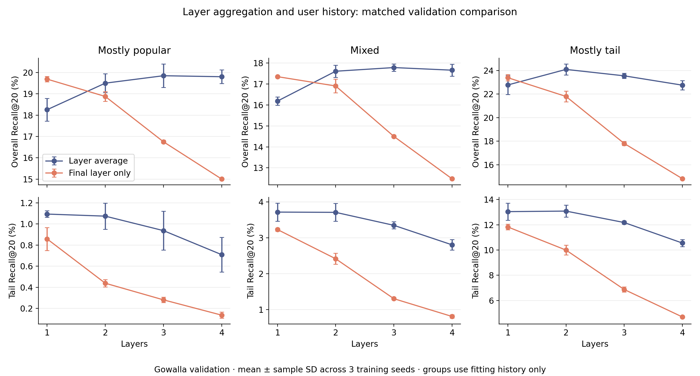
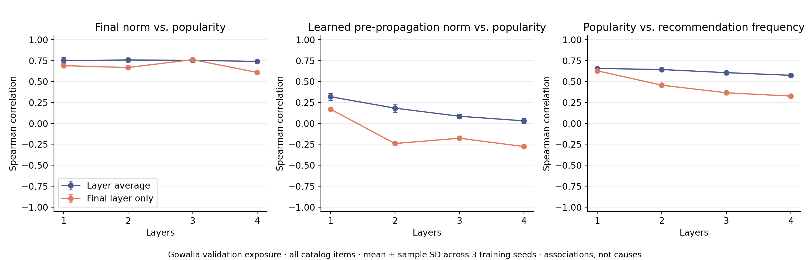

# LightGCN-single: user histories and item diagnostics

Completed **November 23, 2026**, ARC job **346542**, node **c2**. This post-hoc analysis compares final-layer-only LightGCN with uniform layer averaging at depths 1–4 and seeds 2020–2022: **24 existing checkpoints**, with no retraining.

**These are validation results, not new test results.** The model/checkpoint roster and thresholds were fixed before running this analysis. Original test outcomes had already been viewed. See [protocol](../../../docs/single-users-items-analysis.md) and [frozen identities](../../../provenance/single-users-items-plan.json).

## Main findings

- In every user group and every training seed, single-output overall recall and tail recall decrease at each additional depth. This holds in all nine seed/group combinations.
- At every matched depth, group and seed, averaging has higher tail recall, tail share and coverage than final-layer-only output: 36 of 36 comparisons for each metric.
- Single output has higher mean overall recall at depth one in all groups, but uniform averaging has higher mean overall recall at depths two through four. More tail recovery is therefore not the same as higher overall accuracy at every depth.
- Popularity and final embedding norms remain positively associated, but the relationship is nonmonotonic with depth. The diagnostics do not establish a causal explanation for concentration.

## Users with mostly-tail fitting histories

Values below are validation percentages, averaged over three training seeds. Tail recall uses the 4,779 users in this group who have validation tail positives, while overall recall uses all 6,331 group members. All groups and sample SD are available in [the complete summary](user-groups-summary.csv).

| Depth | Output | Overall Recall@20 | Tail Recall@20 | Tail share@20 | Coverage@20 |
| --- | --- | ---: | ---: | ---: | ---: |
| 1 | Final layer only | 23.38 | 11.83 | 28.30 | 27.88 |
| 1 | Layer average | 22.77 | 13.04 | 35.18 | 35.98 |
| 2 | Final layer only | 21.79 | 10.00 | 25.48 | 19.57 |
| 2 | Layer average | 24.09 | 13.09 | 31.40 | 31.76 |
| 3 | Final layer only | 17.80 | 6.87 | 20.46 | 13.26 |
| 3 | Layer average | 23.54 | 12.18 | 28.60 | 27.31 |
| 4 | Final layer only | 14.81 | 4.70 | 17.33 | 9.82 |
| 4 | Layer average | 22.75 | 10.55 | 25.43 | 23.20 |



Group assignment uses fitting interactions only, with the same boundaries as the earlier test analysis. Group sizes are 8,196 mostly-popular, 15,331 mixed and 6,331 mostly-tail users. Their validation tail-recall denominators are 3,913, 10,295 and 4,779, respectively. These are observed-history labels, not claims about true personal preferences.

## Item relationships

Spearman correlation means over all catalog items and three seeds:

| Depth | Output | Final norm vs. popularity | Learned pre-propagation norm vs. popularity | Popularity vs. exposure |
| --- | --- | ---: | ---: | ---: |
| 1 | Final layer only | 0.689 | 0.170 | 0.628 |
| 1 | Layer average | 0.751 | 0.319 | 0.656 |
| 2 | Final layer only | 0.667 | -0.241 | 0.456 |
| 2 | Layer average | 0.757 | 0.182 | 0.643 |
| 3 | Final layer only | 0.761 | -0.177 | 0.366 |
| 3 | Layer average | 0.753 | 0.085 | 0.606 |
| 4 | Final layer only | 0.608 | -0.277 | 0.326 |
| 4 | Layer average | 0.739 | 0.030 | 0.574 |



Final-output norm versus popularity does not consistently strengthen with depth. For single-output models, the learned pre-propagation norm has a negative mean rank correlation with popularity at depths two through four. This describes learned parameters and is not evidence of a particular compensation mechanism.

Popularity/exposure rank correlation falls more steeply with depth for single-output models, while their tail share and coverage also fall. Ranking agreement across items and popular/tail shares measure different things. A lower correlation alone is not evidence of reduced popularity bias.

For the final-layer-only architecture, final norm and last-layer norm refer to the same output tensor by definition. The export reuses that tensor rather than rerunning CUDA sparse propagation solely to duplicate the measurement. Uniform averaging has distinct final and last-layer norms.

## Verification and reproducibility

All 24 checkpoint hashes and input-data hashes passed. Group exposures and weighted user metrics reconcile with each inference run. Saved overall validation metrics reproduce within the prespecified tolerance: the largest absolute metric deviation is 1.67459307e-06, and the largest exposure-count L1 difference is 2. Earlier result files remain the reference; these small reranking differences are recorded, not overwritten.

The independent artifact audit passed both on ARC and after download. Re-run from the repository root:

```bash
python scripts/audit_single_users_items.py results/gowalla/single-users-items-job346542
```

[Audit and checkpoint verification](audit.json), [per-run user results](user-groups-per-run.csv), [group profiles](group-profiles.csv), [per-run item correlations](item-correlations-per-run.csv) and [item correlation summaries](item-correlations-summary.csv) are included. Each checkpoint also has a compressed item-level table and a verification JSON. Item tables contain item IDs and aggregate exposure, not user IDs or user histories. No per-user assignments or recommendation lists are exported.

Figures show mean ± sample SD across training seeds. The same dataset and split are shared by every run. This is descriptive post-hoc validation analysis, not a significance test, new held-out test comparison, causal fairness result or online evaluation.

[inference-sources.tar.gz](inference-sources.tar.gz) preserves the exact inference source and plan bytes matching audit hashes. Git may normalize line endings in the editable repository copies.
