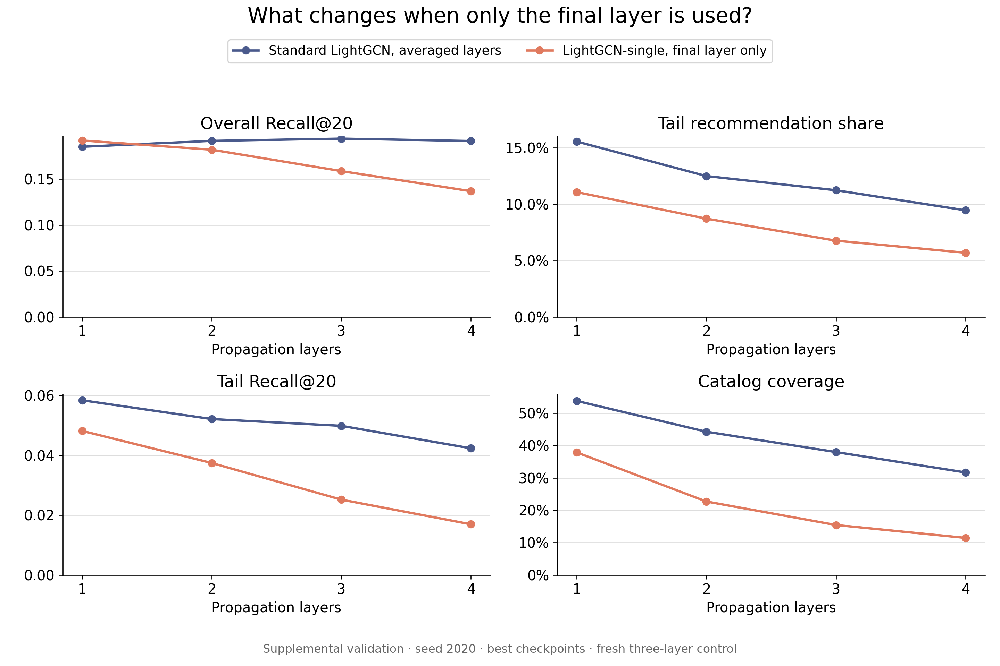

# Completed LightGCN-single supplemental validation comparison

This comparison addresses the proposal's final-layer-only ablation. All eight entries use training seed 2020, the same fitting/validation split, embedding size 64, BPR loss, Adam settings, batch size 1024, standard normalization, a 500-epoch maximum, and patience 20. Each checkpoint was selected by validation Recall@20. Standard K=3 uses the fresh uninterrupted control.

This is a single-seed validation study conducted after the frozen final-test comparison. It is separate from the three-seed final-test findings. No final-test labels were evaluated for the new single-output models.

| Layers | Combination | Recall@20 | Tail share | Coverage | Gini | Tail Recall@20 |
| --- | --- | ---: | ---: | ---: | ---: | ---: |
| 1 | uniform | 0.18513 | 15.55% | 53.78% | 0.88167 | 0.05843 |
| 1 | single | 0.19197 | 11.07% | 37.87% | 0.92209 | 0.04819 |
| 2 | uniform | 0.19153 | 12.49% | 44.26% | 0.91259 | 0.05215 |
| 2 | single | 0.18192 | 8.71% | 22.70% | 0.95580 | 0.03745 |
| 3 | uniform | 0.19399 | 11.23% | 37.98% | 0.92714 | 0.04989 |
| 3 | single | 0.15866 | 6.76% | 15.45% | 0.97138 | 0.02520 |
| 4 | uniform | 0.19139 | 9.45% | 31.69% | 0.94090 | 0.04237 |
| 4 | single | 0.13679 | 5.69% | 11.46% | 0.97892 | 0.01696 |

## Interpretation

Within LightGCN-single, increasing depth from one to four layers reduces overall recall, tail share, tail recall, and coverage. Gini increases. Across these settings, its best overall recall occurs at one layer.

At every depth, uniform layer averaging has higher tail share, tail recall, and coverage and lower Gini than final-layer-only output. Averaging also has higher overall recall at depths 2–4. At one layer, single output has higher overall recall but lower tail relevance and exposure. These findings support retaining layer combination when examining deeper LightGCN models under this protocol. They do not establish over-smoothing as the cause or generalization to other seeds or datasets.

[SVG figure](supplemental-single-figures/single-versus-uniform.svg) and [full-precision comparison CSV](supplemental-single-comparison.csv).

## Completion and recovery

| Layers | Completed run | Best epoch | Stopped epoch |
| --- | --- | ---: | ---: |
| 1 | [lightgcn-single-k1-seed2020-job340255_1](lightgcn-single-k1-seed2020-job340255_1/) | 258 | 278 |
| 2 | [lightgcn-single-k2-seed2020-job340255_2](lightgcn-single-k2-seed2020-job340255_2/) | 234 | 254 |
| 3 | [lightgcn-single-k3-seed2020-resumed-job340333_3](lightgcn-single-k3-seed2020-resumed-job340333_3/) | 361 | 381 |
| 4 | [lightgcn-single-k4-seed2020-resumed-job340333_4](lightgcn-single-k4-seed2020-resumed-job340333_4/) | 242 | 262 |

Depths 1 and 2 completed in the original array. BeeGFS communication errors interrupted depths 3 and 4 on c0 and c23. Recovery array 340333 completed both successfully, using their last intact checkpoints at epochs 141 and 63. Their complete histories include the durable parent history. Model, optimizer, random-generator states, best checkpoint, and patience counter were restored. The first replayed validation results match the previously logged but unsaved epochs.

Each recovered directory contains `resume-preparation.json` with original checkpoint hashes and the discarded uncheckpointed epoch. Original interrupted histories and configurations are preserved under `archive/interrupted-single-k3-job340255_3/` and `archive/interrupted-single-k4-job340255_4/`.

Checks reproduced strict-best checkpoint selection, exact patience-20 stopping, full history continuity, preserved parent history, the resumed first epoch, split/model settings, and item exposure totals. Exposure tables independently reproduce coverage, tail share, and Gini. Recall/NDCG and tail recall are evaluator measurements.

[Supplemental protocol and commands](../../docs/supplemental-analysis.md). Full checkpoints remain on ARC.
