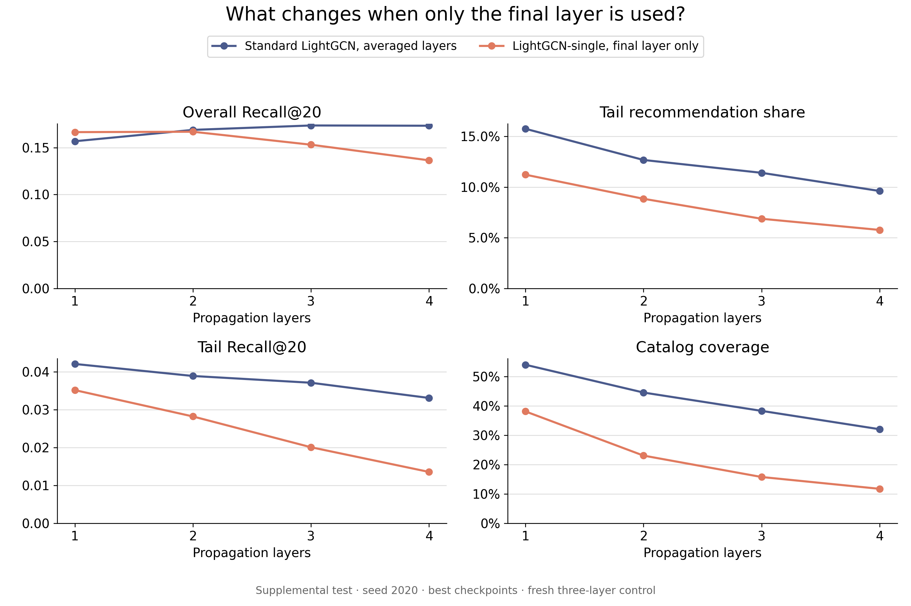

# Supplemental LightGCN-single test results

ARC job 340785 completed successfully with exit code 0 in 34 seconds. All four frozen checkpoints reproduced their six validation metrics and exact item-exposure counts before this evaluator opened test labels. All four then completed test evaluation.

This is a post-hoc supplemental comparison. The original 23-entry final-test results were already known when the extension was planned. The four existing best-validation checkpoints, configurations, seed 2020, and evaluation rules were frozen before this supplemental run. No model was retrained, retuned, or reselected against these test outcomes.

## Matched seed-2020 test comparison

Standard-model rows come from the original frozen test job 337725. Single-output rows come from the separate supplemental test job 340785. Both use identical fitting/validation/test hashes, fitting-only graphs and popularity groups, full-catalog top-20 ranking, and fitting-plus-validation exclusions. K=3 uses the fresh uninterrupted standard control.

| Layers | Combination | Recall@20 | NDCG@20 | Tail share | Coverage | Gini | Tail Recall@20 |
| --- | --- | ---: | ---: | ---: | ---: | ---: | ---: |
| 1 | uniform | 0.15674 | 0.13197 | 15.76% | 54.04% | 0.88022 | 0.04211 |
| 1 | single | 0.16645 | 0.14020 | 11.23% | 38.13% | 0.92104 | 0.03519 |
| 2 | uniform | 0.16883 | 0.14485 | 12.68% | 44.57% | 0.91130 | 0.03893 |
| 2 | single | 0.16687 | 0.13903 | 8.85% | 23.06% | 0.95506 | 0.02823 |
| 3 | uniform | 0.17354 | 0.14794 | 11.41% | 38.32% | 0.92599 | 0.03714 |
| 3 | single | 0.15306 | 0.12362 | 6.87% | 15.76% | 0.97092 | 0.02009 |
| 4 | uniform | 0.17327 | 0.14712 | 9.62% | 32.06% | 0.93992 | 0.03312 |
| 4 | single | 0.13641 | 0.10742 | 5.77% | 11.73% | 0.97859 | 0.01356 |

## Findings

Uniform averaging has higher tail share, tail recall, and coverage, and lower Gini, than final-layer-only output at every tested depth. It also has higher overall recall at depths 2–4. At one layer, single output has higher overall recall but lower tail relevance and exposure.

Within LightGCN-single, tail share falls from 11.23% at one layer to 5.77% at four, and tail recall and coverage also decrease with depth. Overall test recall is close at one and two layers, with two layers numerically slightly higher, before falling at three and four. This differs from the validation ordering where one layer was highest. The small one-versus-two test difference is descriptive and is not used for new model selection.

These are one-seed results. They remain separate from the original three-seed means and standard deviations. They do not establish significance or identify over-smoothing as the mechanism.

[SVG](figures/single-versus-uniform.svg), [matched comparison CSV](comparison.csv), and [the original validation supplement](../supplemental-single-comparison.md).

## Verification and provenance

- [Frozen supplemental plan](../../../provenance/supplemental-single-test-plan.json), published before evaluation in commit `a54be03`.
- [Complete validation verification](validation-verification.json) and [test completion](test-completion.json), with unchanged evaluator and checkpoint hashes.
- [Per-model test table](test-per-run.csv), plus per-run metrics and full item counts under `verify/` and `test/`.
- [Artifact audit](artifact-audit.json). Reproduce its read-only checks with `python results/gowalla/supplemental-single-test-job340785/audit_artifacts.py`.
- All evaluations use 29,858 users and 597,160 slots. Test tail recall averages over 26,839 users with tail positives.
- Independent artifact checks reproduce exposure metrics and compare source/checkpoint identities. Recall, NDCG, and tail recall are evaluator measurements, without an independent reranking implementation.
