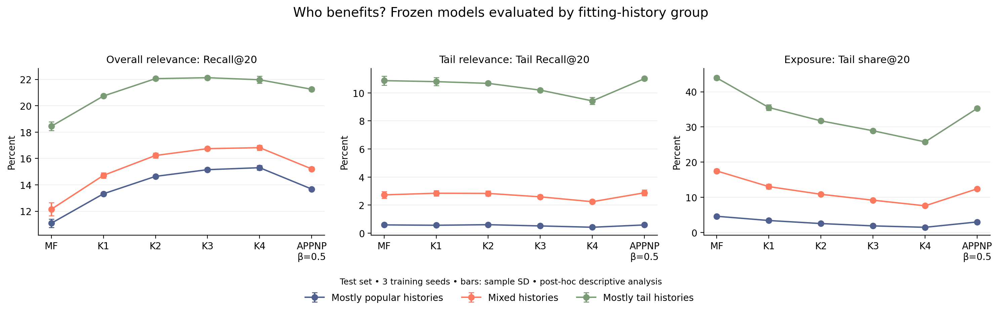

# Who benefits? User-group analysis

ARC job **340789** completed November 12, 2026. This post-hoc analysis reuses all 18 frozen main-comparison checkpoints: MF, standard LightGCN K=1–4, and APPNP-style beta=0.5, each with training seeds 2020–2022. No retraining or checkpoint selection changed.

## Groups and method

For each user, calculate the fraction of fitting interactions involving tail items. Tail means the existing bottom 80% of items by fitting degree. These are observed-history groups, not claims about true preferences.

| Fitting-history group | Rule | Users | Mean fitting tail fraction | Median fitting interactions |
| --- | --- | ---: | ---: | ---: |
| Mostly popular | Tail fraction ≤ 1/3 | 8,196 | 22.26% | 15 |
| Mixed | 1/3 < tail fraction < 2/3 | 15,331 | 49.33% | 17 |
| Mostly tail | Tail fraction ≥ 2/3 | 6,331 | 77.56% | 12 |

Assignments were generated before opening held-out labels in this evaluator. Original overall test results were already known. The [protocol](../../../provenance/user-group-plan.json) was committed before analysis; its numerical-verification amendment is recorded explicitly. Ranking uses the same full catalog, top 20 and exclusion of fitting plus validation interactions as the main test.

## Results

More depth gives different trade-offs across groups. For mostly-tail users, K=2 and K=3 have similar overall Recall@20; K=4 adds no mean recall benefit over K=2 while reducing tail relevance and exposure. Mostly-popular and mixed groups have slightly increasing mean overall recall through K=4.

All numbers below are test percentages, averaged over three training seeds. The [full summary](summary.csv) includes sample SD and all six metrics.

| Group | Model | Recall@20 | Tail Recall@20 | Tail share@20 |
| --- | --- | ---: | ---: | ---: |
| Mostly popular | K=2 | 14.65 | 0.61 | 2.53 |
| Mostly popular | K=4 | 15.30 | 0.43 | 1.47 |
| Mostly popular | APPNP beta=0.5 | 13.68 | 0.59 | 2.99 |
| Mixed | K=2 | 16.23 | 2.84 | 10.86 |
| Mixed | K=4 | 16.82 | 2.25 | 7.58 |
| Mixed | APPNP beta=0.5 | 15.21 | 2.88 | 12.42 |
| Mostly tail | K=2 | 22.05 | 10.68 | 31.73 |
| Mostly tail | K=3 | 22.13 | 10.19 | 28.92 |
| Mostly tail | K=4 | 21.97 | 9.43 | 25.75 |
| Mostly tail | APPNP beta=0.5 | 21.25 | 11.02 | 35.28 |

APPNP beta=0.5 has higher mean tail recall and exposure than standard K=3 in every group, with lower overall recall. These descriptive comparisons do not establish statistical significance.



**Presentation wording:** “Overall accuracy hides a trade-off. For users whose history mostly contains less-popular places, deeper propagation gives little extra overall recall beyond two layers, while recovering fewer relevant less-popular places. APPNP-style weights recover some tail recommendations at an overall accuracy cost.”

## Limits

- Mostly-tail users have higher absolute overall and tail recall than the other groups here. The finding concerns changes between models within each group; do not claim these users have the lowest accuracy.
- Tail Recall@20 uses only users with test tail positives: 6,755 mostly-popular, 14,126 mixed and 5,958 mostly-tail users. Overall recall uses every test user in each group.
- Tail share measures exposure; tail recall measures recovery of relevant tail items. They answer different questions.
- History length, geographic availability and past exposure may differ between groups. Results do not prove a causal mechanism or unfair treatment. Matching historical tail shares is not automatically optimal.
- Error bars are sample SD over three training seeds, not confidence intervals over users. There is one dataset and one fixed split. No new model was selected using these outcomes.

## Verification and files

All checkpoint hashes match the frozen original test records. Group counts, tail-positive denominators and per-item exposures reconcile with each rerun's overall values. Overall metrics are within absolute tolerance 1e-5 of the original measurements.

Seventeen checkpoints reproduce all original metrics and exposures exactly. For K=2 seed2021, Recall differs by +0.0000004350 and NDCG by +0.0000010831. Tail share, coverage and tail recall match exactly. Exposure-count vectors have L1 difference 2 across 597,160 slots; Gini differs by +0.0000001303. The cause was not established; floating-point near-tie rankings are a possible explanation. Original results are preserved. Strict initial attempts 340787/340788 stopped on this discrepancy before the completed run.

`group-profiles.csv` describes aggregate groups; `per-run.csv` contains 54 grouped rows; `summary.csv` contains 108 mean/SD rows; `audit.json` records checkpoint identities and deviations; `*-overall-check.json` preserves measured and original overall values. PNG/SVG figures are in `figures/`. Per-user assignments in `user-groups.csv` remain local and on ARC and are excluded from GitHub.

Audit from the repository root:

```bash
python scripts/audit_user_groups.py results/gowalla/user-groups-job340789
```

This checks saved denominators, seed summaries and reproduction records. If the local-only assignment file is present, it also checks 29,858 assignments and group boundaries; otherwise it explicitly skips that part. Inference-time assertions performed the per-item exposure reconciliation. Evaluation uses `scripts/analyze_user_groups_arc.sh` with project-specific ARC paths; figure generation uses `scripts/plot_user_groups.py`.
